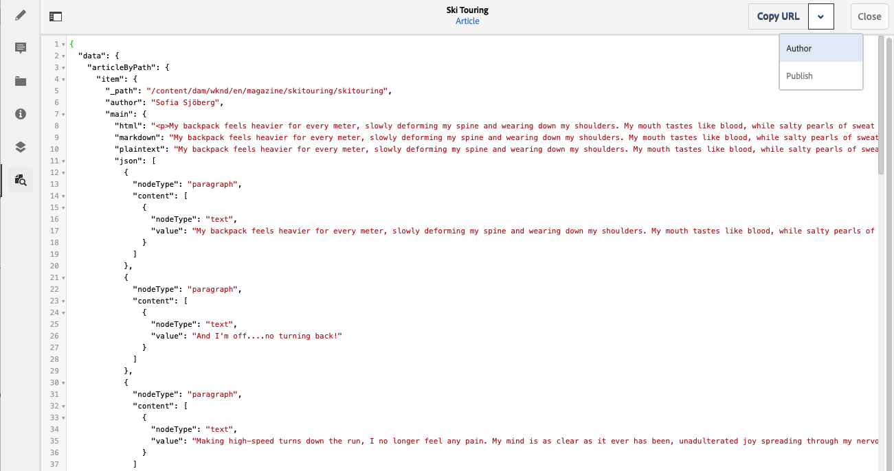

# 預覽 - JSON 代表 {#preview-json-representation}

將內容片段的模型開發為AEM Headless實作的一部分時，您可以使用內容片段編輯器來檢視內容片段的範例JSON輸出（根據模型）。 例如，瞭解最終輸出的外觀。 在驗證模型JSON結構時，這可能有所幫助，針對每種資料型別可能有預設範例內容。

使用&#x200B;**預覽**&#x200B;圖示：

您可以檢視目前片段的JSON表示法。 例如：

<!--
**Copy URL** lets you copy to clipboard the URL for either author or publish.
-->
