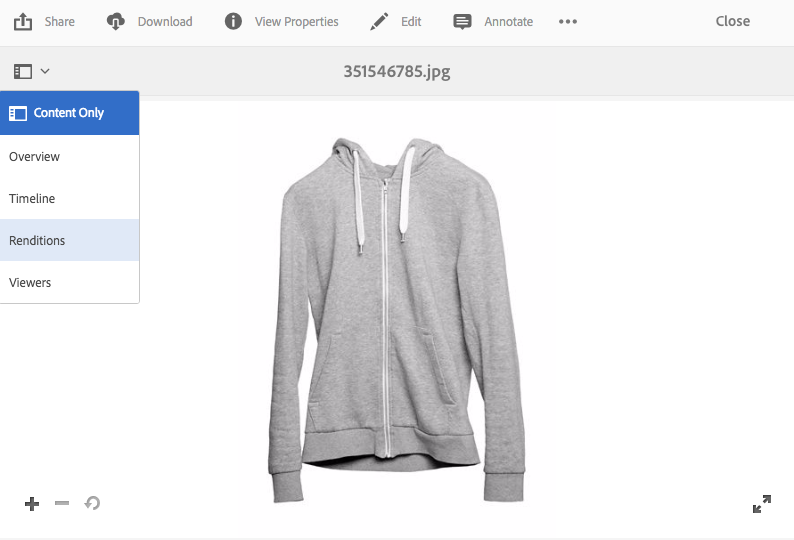

# 為回應式網站傳遞最佳化影像 {#delivering-optimized-images-for-a-responsive-site}

當您想要與網頁開發人員共用用於回應式服務的程式碼時，請使用回應式程式碼功能。 您將回應式(**[!UICONTROL RESS]**)代碼複製到剪貼簿，以便與網頁開發人員共用。

如果您的網站位於協力廠商WCM上，則使用此功能較為合理。 不過，如果您的網站改在Adobe Experience Manager上，則站外影像伺服器會轉譯影像並將其提供給網頁。

另請參閱[將視訊檢視器內嵌在網頁上](embed-code.md)。

另請參閱[將URL連結至您的網頁應用程式](linking-urls-to-yourwebapplication.md)。

**若要傳送回應式網站的最佳化影像：**

1. 導覽至您要提供回應式程式碼的影像，然後在下拉式選單中選取&#x200B;**[!UICONTROL 轉譯]**。

   

1. 選取回應式影像預設集。 URL **[!UICONTROL 和]**&#x200B;**[!UICONTROL RESS]** 按鈕出現。

   

   >[!NOTE]
   >
   >必須發佈 *選取的資產* ，以及選取的影像預設集或檢視器預設集，才能使 **[!UICONTROL URL]** 或 **[!UICONTROL RESS]** 按鈕可用。
   >
   >Dynamic Media — 混合模式需要您發佈影像預設集；Dynamic Media - Scene7模式會自動發佈影像預設集。

1. 選取&#x200B;**[!UICONTROL RESS]**。

   

1. 在&#x200B;**[!UICONTROL 內嵌回應式影像]**&#x200B;對話方塊中，選取並複製回應式程式碼文字，然後貼到您的網站以存取回應式資產。
1. 直接在內嵌程式碼中編輯預設中斷點，以符合回應式網站的中斷點。 此外，測試在不同頁面中斷點提供的不同影像解析度。

## 使用HTTP/2傳送您的Dynamic Media資產 {#using-http-to-delivery-your-dynamic-media-assets}

HTTP/2是新的、更新的Web通訊協定，可改善瀏覽器和伺服器的通訊方式。 它提供更快速的資訊傳輸，並減少所需的處理能力。 HTTP/2可支援動態媒體資產的傳送，提供更出色的回應和載入時間。

請參閱[HTTP2內容傳送](http2.md)，以取得有關透過您的Dynamic Media帳戶開始使用HTTP/2的完整詳細資料。
