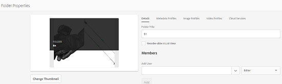
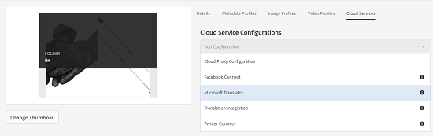
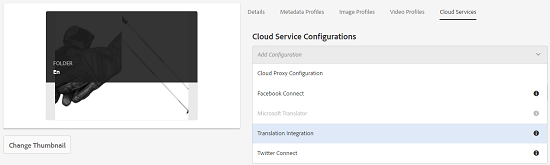
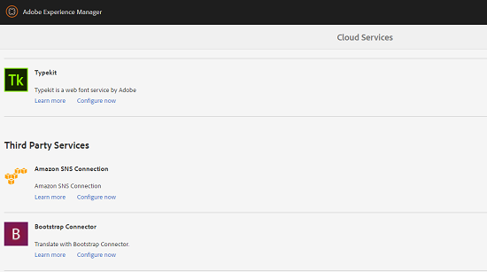
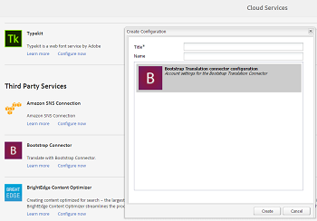
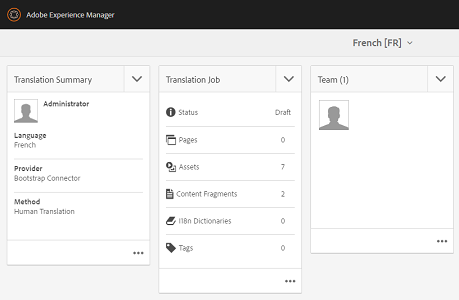

# 將翻譯雲端服務套用至資料夾 {#applying-translation-cloud-services-to-folders}

[!DNL Adobe Experience Manager]可讓您從您選擇的翻譯提供者取得雲端型翻譯服務，以確保您的資產會根據您的需求進行翻譯。

您可以將翻譯雲端服務直接套用至資產檔案夾，以便在翻譯工作流程中使用。

## 套用翻譯服務 {#applying-the-translation-services}

將翻譯雲端服務直接套用至您的資產檔案夾，讓您在建立或更新翻譯工作流程時，無需設定翻譯服務。

1. 從[!DNL Assets]使用者介面中，選取您要套用翻譯服務的資料夾。
1. 在工具列中按一下&#x200B;**[!UICONTROL 屬性]**&#x200B;以顯示&#x200B;**[!UICONTROL 資料夾屬性]**&#x200B;頁面。

   

1. 導覽至「 **[!UICONTROL 雲端服務]** 」標籤。
1. 從Cloud Service設定清單中，選擇所需的翻譯提供者。 例如，如果您想使用Microsoft的翻譯服務，請選擇&#x200B;**[!UICONTROL Microsoft翻譯工具]**。

   

1. 選擇翻譯提供者的聯結器。

   

1. 在工具列中按一下[儲存]，然後按一下[確定]，關閉對話方塊。********&#x200B;翻譯服務會套用至資料夾。

## 套用自訂翻譯聯結器  {#applying-custom-translation-connector}

如果要為要用於翻譯工作流的翻譯服務應用自定義連接器。 若要套用自訂連接器，請先從「封裝管理員」安裝連接器。 然後，從雲端服務主控台設定連接器。 在您設定連接器後，「套用轉譯服務」中所述的「雲端服務」標籤中的連接器清 [單中會顯示此連接器](transition-cloud-services.md#applying-the-translation-services)。 在您應用自定義連接器並運行翻譯工作流後，翻譯項目的「 **[!UICONTROL Translation Summary]** 」 (翻譯摘要) 表徵圖會在heads **[!UICONTROL Provider]** and **[!UICONTROL Method下顯示連接器詳細資訊]**。

1. 從封裝管理員安裝聯結器。
1. 按一下[!DNL Experience Manager]標誌，並導覽至&#x200B;**[!UICONTROL 工具]** > **[!UICONTROL 部署]** > **[!UICONTROL 雲端服務]**。
1. 在「雲端服務」頁面的「 **[!UICONTROL 協力廠商服務]** 」下，找 **[!UICONTROL 出您安裝的連接器]** 。

   

1. 按一下&#x200B;**[!UICONTROL 立即設定]**&#x200B;連結以開啟&#x200B;**[!UICONTROL 建立設定]**&#x200B;對話方塊。

   

1. 指定聯結器的標題和名稱，然後按一下[建立]。**** 自訂連接器位於「套用轉譯服務」步驟5中所述「 **[!UICONTROL 雲端服務]** 」標籤的連 [接器清單中](#applying-the-translation-services)。
1. 在套用自訂連接器後，執行「 [建立翻譯專案](translation-projects.md) 」中所述的任何翻譯工作流程。 驗證「項目」控制台中翻譯項 **[!UICONTROL 目的「翻譯摘要]** 」表徵圖中連接器的詳 **[!UICONTROL 細資訊]** 。

   
