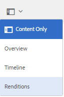

# 視訊轉譯 {#video-renditions}

Adobe Experience Manager Assets會為各種格式（包括OGG、FLV等）的視訊資產產生視訊轉譯。

Experience Manager Assets支援媒體資產的靜態和動態轉譯（DM編碼的轉譯）。

靜態轉譯是使用FFMPEG （已安裝並可在系統路徑上使用）以原生方式產生，並儲存在內容存放庫中。

DM編碼的轉譯會儲存在Proxy伺服器中，並在執行階段提供服務。

Experience Manager Assets在使用者端提供這些轉譯的播放支援。

若要檢視特定視訊資產的轉譯，請開啟其資產頁面，然後選取「全域導覽」圖示。 然後從清單中選擇&#x200B;**[!UICONTROL 轉譯]**。

視訊轉譯清單會顯示在&#x200B;**[!UICONTROL 轉譯]**&#x200B;面板中。

若要設定DM編碼轉譯的Proxy伺服器，[設定Dynamic Media雲端服務](config-dynamic.md)。

若要使用所需的引數產生視訊轉譯，[請建立對應的視訊設定檔](video-profiles.md)。

在您設定Proxy伺服器並建立視訊設定檔後，即可在處理設定檔中納入此視訊預設集，並將處理設定檔套用至資料夾。

>[!NOTE]
>
>® Internet Explorer 11上的OGG和WAV檔案無法播放音訊。 錯誤`Invalid Source`會顯示在副檔名為OGG或WAV之資產的資產詳細資訊頁面上。
>
>在MS® Edge和iPad上，OGG檔案不會播放並引發不支援的格式錯誤。
