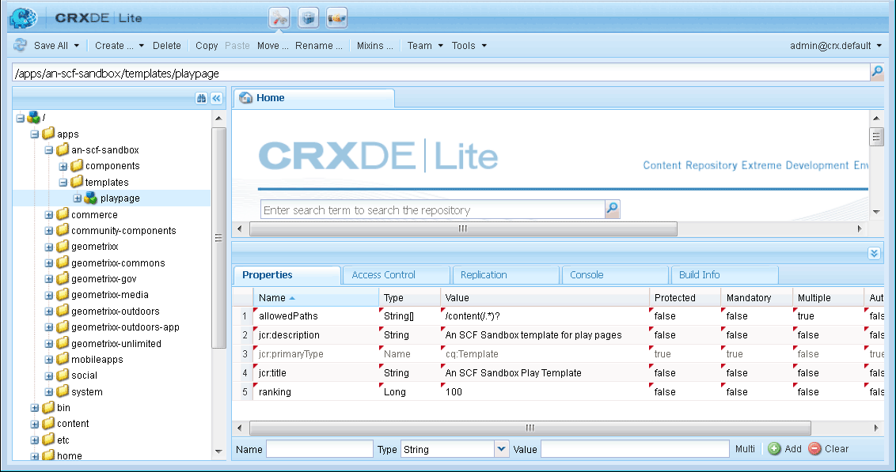
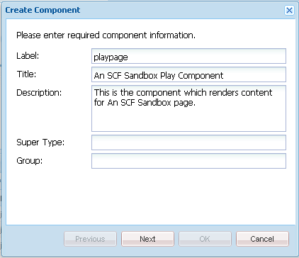

# 變更外觀 {#alter-the-appearance}

## 修改指令碼 {#modify-the-script}

`comment.hbs`指令碼負責為每個註解建立整體HTML。

不顯示每個張貼的評論旁的頭像：

1. 將`comment.hbs`從`libs`複製到`apps`

   1. 選取`/libs/social/commons/components/hbs/comments/comment/comment.hbs`
   1. 選取&#x200B;**[!UICONTROL 副本]**
   1. 選取`/apps/social/commons/components/hbs/comments/comment`
   1. 選取&#x200B;**[!UICONTROL 貼上]**

1. 開啟覆蓋的`comment.hbs`

   * 連按兩下`/apps/social/commons/components/hbs/comments/comment folder`中的節點`comment.hbs`

1. 找出下列行，然後刪除或註解它們：

```xml
  <aside class="scf-comment-author">
        </img>
```

請刪除這些行，或以`<!--`和`-->`括住這些行，以便您將其註解。 此外，字元「xxx」會新增為顯示虛擬人偶位置的視覺指標。

```xml
   xxx
   <!-- do not display avatar with comment
    <aside class="scf-comment-author">
        </img>
```

### 復寫覆蓋 {#replicate-the-overlay}

使用復寫工具將覆蓋的註解元件推送至發佈例項。

>[!NOTE]
>
>更強大的復寫形式是在封裝管理員中建立封裝，並[啟動](/help/sites-administering/package-manager.md#replicating-packages)。 套件可以匯出和封存。

從全域導覽中選取&#x200B;**[!UICONTROL 工具]** > **[!UICONTROL 部署]** > **[!UICONTROL 復寫]**，然後按一下&#x200B;**[!UICONTROL 啟動樹狀結構]**。

開始路徑請輸入`/apps/social/commons`並選取&#x200B;**[!UICONTROL 啟動]**。



### 檢視結果 {#view-results}

如果您以管理員身分登入發佈執行個體，例如https://localhost:4503/crx/de ，以管理員/管理員身分登入，則可驗證是否有覆蓋的元件。

如果您登出，然後以`aaron.mcdonald@mailinator.com/password`身份登入並重新整理頁面，您會發現顯示圖片時沒有張貼的註解。 而是顯示簡單的「xxx」。


