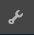

# 使用投票 {#using-voting}

`Voting`元件是實用的工具，可讓社群成員為特定內容評分，例如QnA元件中的答案。 使用`Voting`元件時，成員會選取向上或向下箭頭來表示其意見。

## 新增投票至頁面 {#adding-voting-to-a-page}

若要將`Voting`元件新增至作者模式的頁面，請使用元件瀏覽器。 找到`Communities / Voting`並將其拖曳到頁面上某個位置，例如與功能相對的位置以供使用者投票。

如需必要資訊，請造訪[社群元件基本知識](basics.md)。

當包含[必要的使用者端資料庫](essentials-voting.md#essentials-for-client-side)時，`Voting`元件就會以這種方式顯示。

## 設定投票 {#configuring-voting}

選取置入的`Voting`元件，以便您可以存取並選取開啟編輯對話方塊的`Configure`圖示。

在&#x200B;**[!UICONTROL 文字和標籤]**&#x200B;標籤下，指定用來記錄投票的屬性。

* **[!UICONTROL 正面回應標籤]**

  （*必要*）正面回應的內部屬性名稱。

* **[!UICONTROL 負面回應標籤]**

  （*必要*）負面回應的內部屬性名稱。

* **[!UICONTROL 記帳名稱]**

  （*必要*）此投票元件執行個體的內部可識別屬性名稱。

## 網站訪客體驗 {#site-visitor-experience}

### 成員 {#members}

成員只能投票一次，但可隨時變更投票。

### 匿名 {#anonymous}

不支援匿名投票。 網站訪客必須註冊（成為會員）並登入才能參與投票一次。

## 其他資訊 {#additional-information}

如需詳細資訊，請參閱開發人員的[投票要點](essentials-voting.md)頁面。
