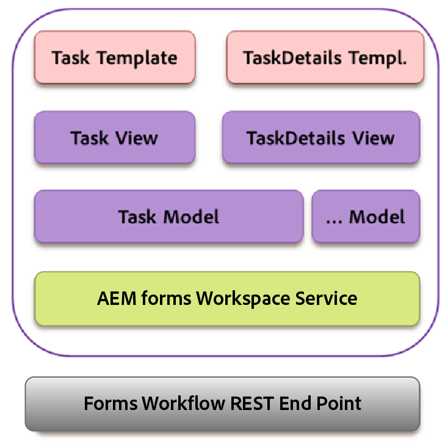

# 主幹互動{#backbone-interaction}

Backbone是程式庫，可協助在Web應用程式中建立和遵循MVC架構。 Backbone的基本構想是將介面組織成邏輯檢視，並以模型為後盾，每個模型都可以在模型變更時獨立更新，而無需重新繪製頁面。 如需有關主幹的詳細資訊，請參閱[https://backbonejs.org](https://backbonejs.org/)。

部分重要概念如下：

**骨幹模型**&#x200B;包含資料，以及與此資料相關的大部分邏輯。

**主幹檢視**&#x200B;用於表示對應模型的狀態。 骨幹檢視的行為實際上像是控制器，會聆聽使用者點按之類的使用者介面事件，或是模型事件（例如資料已變更），並視需要修改使用者介面。

**HTML範本**&#x200B;模型已填入預留位置的包裝函式範本。

**AEM Forms工作區**&#x200B;包含數個個別元件。 每個元件：

* 代表單一邏輯使用者介面元素。
* 可以是類似元件的集合。
* 由骨幹模型、骨幹檢視和HTML範本組成。
* 包含服務的參考。
* 包含所需公用程式的參考。

初始化元件時，會建立下列物件：

* 已建立元件的主幹模型新例項。 服務會插入模型中。
* 已建立骨幹檢視的新執行個體。
* 相應模型、HTML範本和「公用程式」的例項會插入檢視中。

在骨幹檢視中，有一個事件對應對應可對應由於使用者介面與對應處理常式的互動而產生的各種事件。 在初始化元件後，就會起始此對應。

初始化檢視時，檢視會呼叫其對應的模型，以從伺服器擷取資料。 檢視所需的所有資料都可供使用後，該檢視就會以HTML範本指定的格式呈現資料。 多個檢視可以共用相同的通訊模型。

範例：

1. 使用者按一下工作清單中的工作範本。
1. 任務檢視會監聽點選，並呼叫任務模型上的轉譯器函式。
1. 工作模型隨後會呼叫該服務，這是所有與AEM Forms伺服器通訊的共同點。
1. 服務類別會透過ajax呼叫轉譯方法的AEM Forms REST端點。
1. 此Ajax叫用的成功回呼是在任務模型中定義的。
1. 任務模型引發骨幹事件，作為轉譯器呼叫完成的通知。
1. 另一個檢視、任務詳細資訊檢視會從任務模型監聽此事件。
1. 任務詳細資訊檢視接著會變更任務詳細資訊範本，以便將轉譯的工作（表單、詳細資訊、附件、附註等）顯示給使用者。
