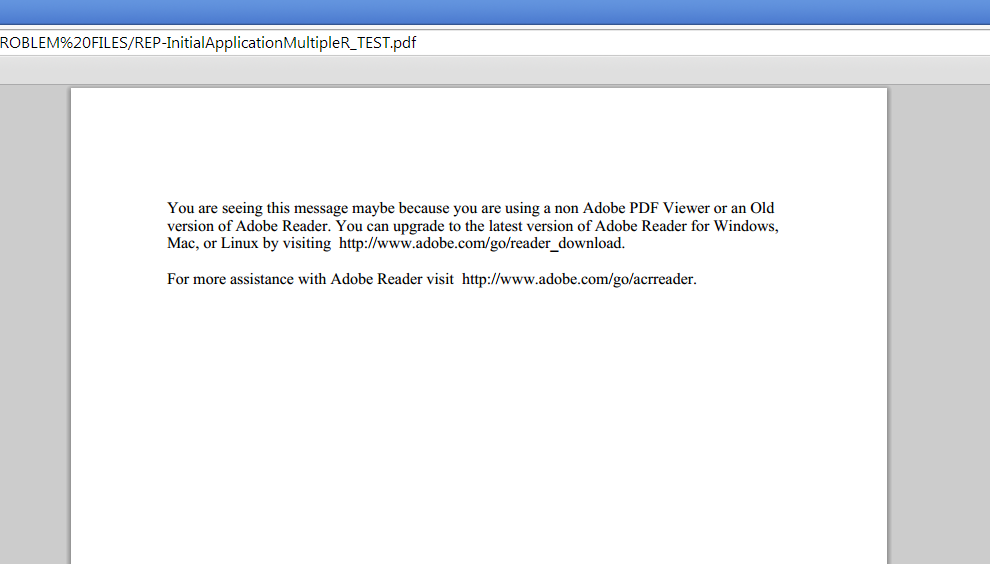

# 在 Designer 中變更頁面零內容 {#changing-page-zero-content-in-designer}

當非Adobe PDF檢視器（例如[!DNL Chrome]或[!DNL Firefox]中的預設PDF檢視器）無法讀取PDF/XFA表單的內容時，預設會顯示「頁面零」內容。 預設的「頁面零」訊息顯示如下。

[!DNL AEM Forms]版Designer可讓您變更顯示在第0頁的訊息。 若要變更「頁面零」訊息，請執行下列步驟：

1. 確定您已安裝[!DNL AEM Forms]版本的Designer。 您可以從設計工具的「關於」畫面中檢查版本。

1. 開啟您要變更「頁面零」內容的表單。

1. 按一下&#x200B;**[!UICONTROL 檔案]** > **[!UICONTROL 表單屬性]**。

1. 在[!UICONTROL 表單屬性]對話方塊中，按一下 （加號圖示）以新增自訂屬性。

1. 將&#x200B;**_pagezerocontent**&#x200B;指定為屬性的名稱。
1. 新增RTF格式的「頁面零」訊息作為值。 例如：

   `<body xmlns="http://www.w3.org/1999/xhtml" xmlns:xfa="http://www.xfa.org/schema/xfa-data/1.0/">
 

You are seeing this message maybe because you are using a non Adobe PDF Viewer or an Old version of Adobe Reader. You can upgrade to the latest version of Adobe Reader for Windows, Mac, or Linux by visiting  https://www.adobe.com/go/reader_download.

 

For more assistance with Adobe Reader visit  https://www.adobe.com/go/acrreader.
</body>`

1. 將表單儲存為PDF。

1. 在瀏覽器中檢視PDF表單，以確認訊息已更新。 上述範例值顯示如下：

   

>[!NOTE]
>
>當您重新開啟表單時，您建立的自訂屬性可能無法正確顯示在表單屬性對話方塊中。 不過，它仍可正常運作，且表單會顯示更新的「頁面零」訊息。
