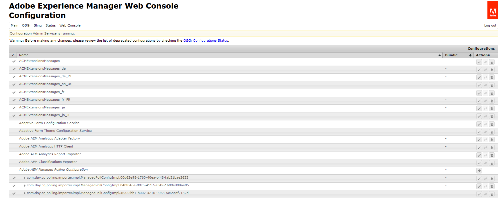

# 正在設定AEM DS設定{#configuring-aem-ds-settings}

本文說明如何設定&#x200B;**AEM DS設定服務**。 此設定可用於多個情境，例如：

* 在通訊管理中

  * 設定AEM Forms工作流程
  * 使用Forms入口網站從遠端儲存草稿/提交內容時

* 在調適型表單中，適用於從發佈執行個體提交調適型表單的情況

以下是設定&#x200B;**[!UICONTROL AEM DS設定]**&#x200B;的步驟：

1. 使用URL在發佈執行個體上開啟Configuration Manager：\
   *https://localhost:port/system/console/configMgr*。

   

1. 在&#x200B;**[!UICONTROL Adobe Experience Manager Web主控台組態]**&#x200B;視窗中，找到並按一下&#x200B;**[!UICONTROL AEM DS設定]**&#x200B;選項。

   

1. **[!UICONTROL AEM DS設定服務]**&#x200B;視窗會顯示AEM DS元件的通用組態設定。

   

1. 在個別欄位中新增下列資訊：

   **[!UICONTROL 處理伺服器URL]**：處理伺服器是必須觸發Forms或AEM工作流程的伺服器。 這可以與AEM編寫執行個體的URL或其他伺服器URL （即https://localhost:port/）相同。

   **[!UICONTROL 正在處理伺服器使用者名稱]**：工作流程使用者的使用者名稱[，根據正在使用的伺服器URL]

   **[!UICONTROL 處理伺服器密碼]**：工作流程使用者的密碼

   >[!NOTE]
   >
   >
   >    
   >    
   >    * 使用Forms或AEM工作流程時，您必須先設定DS設定服務，才能從發佈伺服器提交任何內容。 否則，表單提交將會失敗。
   >    
   >
