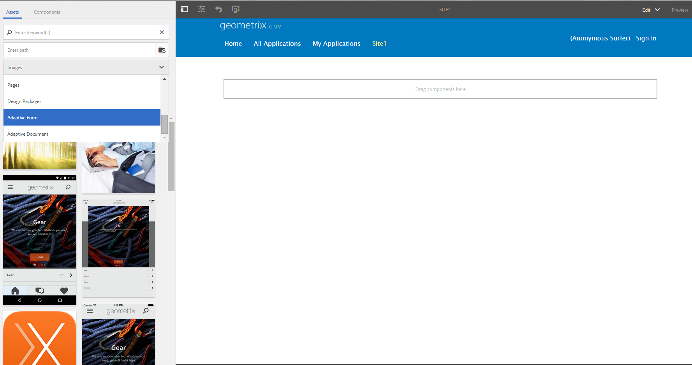
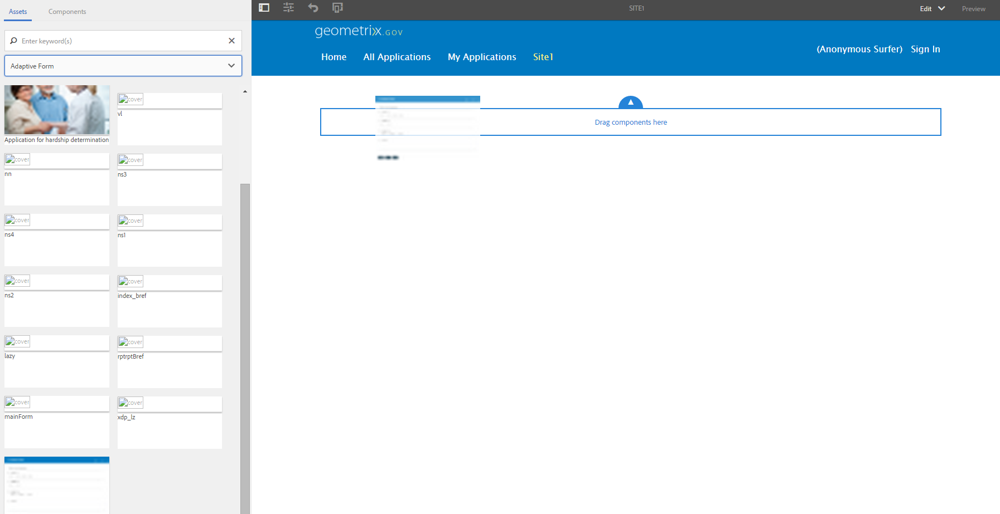

# 使用一組最適化表單建立最適化表單{#create-an-adaptive-form-using-a-set-of-adaptive-forms}

<span class="preview">Adobe 建議使用新式且可擴充的資料擷取[核心元件](https://experienceleague.adobe.com/docs/experience-manager-core-components/using/adaptive-forms/introduction.html?lang=zh-Hant)，用來[建立新的最適化表單](/help/forms/using/create-an-adaptive-form-core-components.md)或[將最適化表單新增到 AEM Sites 頁面](/help/forms/using/create-or-add-an-adaptive-form-to-aem-sites-page.md)。 這些元件代表最適化表單建立方面的重大進步，可確保令人印象深刻的使用者體驗。 本文會介紹使用基礎元件編寫最適化表單的舊方法。</span>

## 概觀 {#overview}

在工作流程中（例如開立銀行帳戶的應用程式），您的使用者會填寫多個表單。 與其要求他們填寫一組表格，您可以將表格棧疊在一起並建立大型表格（父級表格）。 將最適化表單新增至較大表單時，會將其新增為面板（子表單）。 新增一組子表單以建立父表單。 您可以根據使用者輸入顯示或隱藏面板。 父表單的按鈕（例如提交和重設）會覆寫子表單的按鈕。 若要在父表單中新增自適應表單，您可以從資產瀏覽器拖放自適應表單（如自適應表單片段）。

可用的功能包括：

* 獨立製作
* 顯示/隱藏適當的表單
* 延遲載入

獨立編寫和延遲載入等功能，改善了使用個別元件建立父表單時的效能。

>[!NOTE]
>
>您不可以使用XFA型最適化表單/片段做為子表單或父表單。

## 幕後 {#behind-the-scenes}

您可以在上層表單中新增XSD型最適化表單和片段。 父表單的結構與[任何最適化表單](../../forms/using/prepopulate-adaptive-form-fields.md)相同。 將最適化表單新增為子表單時，會將其新增為父表單中的面板。 繫結子表單的資料儲存在父表單XML結構描述之`afBoundData`區段的`data`根下。

例如，您的客戶填寫申請表。 表單的前兩個欄位是名稱和身分。 其XML為：

```xml
<afData>
    <afUnboundData>
        <data />
    </afUnboundData>
    <afBoundData>
        <data xmlns:xfa="https://www.xfa.org/schema/xfa-data/1.0/">
            <applicantName>Sarah Rose</applicantName>
            <applicantId>1234</applicantId>
        </data>
    </afBoundData>
</afData>
```

您在應用程式中新增另一個表格，讓您的客戶填寫其辦公室地址。 子表單的結構描述根目錄為`officeAddress`。 套用`bindref` `/application/officeAddress`或`/officeAddress`。 如果未提供`bindref`，則會將子表單新增為`officeAddress`子樹狀結構。 請參閱下列格式的XML：

```xml
<afData>
    <afUnboundData>
        <data />
    </afUnboundData>
    <afBoundData>
        <data xmlns:xfa="https://www.xfa.org/schema/xfa-data/1.0/">
            <applicantName>Sarah Rose</applicantName>
            <applicantId>1234</applicantId>
            <officeAddress>
                <addressLine>1, Geometrixx City</addressLine>
                <zip>11111</zip>
            </officeAddress>
        </data>
    </afBoundData>
</afData>
```

如果您插入另一個可讓客戶提供住址的表格，請套用`bindref` `/application/houseAddress or /houseAddress.`XML看起來像這樣：

```xml
<afData>
    <afUnboundData>
        <data />
    </afUnboundData>
    <afBoundData>
        <data xmlns:xfa="https://www.xfa.org/schema/xfa-data/1.0/">
            <applicantName>Sarah Rose</applicantName>
            <applicantId>1234</applicantId>
            <officeAddress>
                <addressLine>1, Geometrixx City</addressLine>
                <zip>11111</zip>
            </officeAddress>
            <houseAddress>
                <addressLine>2, Geometrixx City</addressLine>
                <zip>11111</zip>
            </houseAddress>
        </data>
    </afBoundData>
</afData>
```

如果要保留與結構描述根相同的子根名稱（在此範例中為`Address`），請使用索引的bindrefs。

例如，套用bindrefs `/application/address[1]`或`/address[1]`以及`/application/address[2]`或`/address[2]`。 表單的XML為：

```xml
<afData>
    <afUnboundData>
        <data />
    </afUnboundData>
    <afBoundData>
        <data xmlns:xfa="https://www.xfa.org/schema/xfa-data/1.0/">
            <applicantName>Sarah Rose</applicantName>
            <applicantId>1234</applicantId>
            <address>
                <addressLine>1, Geometrixx City</addressLine>
                <zip>11111</zip>
            </address>
            <address>
                <addressLine>2, Geometrixx City</addressLine>
                <zip>11111</zip>
            </address>
        </data>
    </afBoundData>
</afData>
```

您可以使用`bindRef`屬性變更最適化表單/片段的預設子樹狀結構。 `bindRef`屬性可讓您指定指向XML結構描述樹狀結構中某個位置的路徑。

如果子表單未繫結，則其資料會儲存在父表單XML結構描述之`afUnboundData`區段的`data`根下。

您可以將最適化表單新增為子表單多次。 請確定`bindRef`已正確修改，以便每個最適化表單所使用的執行個體指向資料根下的不同子根。

>[!NOTE]
>
>如果不同的表單/片段對應至相同的子根，資料會被覆寫。

## 使用資產瀏覽器將調適型表單新增為子表單 {#adding-an-adaptive-form-as-a-child-form-using-asset-browser}

執行以下步驟，使用資產瀏覽器將最適化表單新增為子表單。

1. 在編輯模式中開啟父表單。
1. 在側邊欄中，按一下&#x200B;**Assets** 。 在Assets下方，從下拉式清單中選取&#x200B;**最適化表單**。
   [](assets/asset-1.png)

1. 拖放您要新增為子表單的最適化表單。
   [](assets/drag-drop-1.png)您拖放的最適化表單會新增為子表單。
