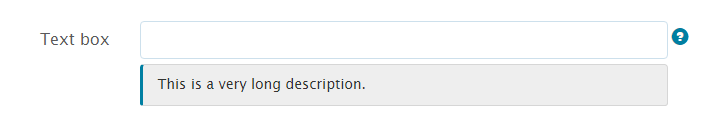

# 最適化表單元件的內嵌樣式 {#inline-styling-of-adaptive-form-components}

Adobe 建議使用新式且可擴充的資料擷取[核心元件](https://experienceleague.adobe.com/docs/experience-manager-core-components/using/adaptive-forms/introduction.html?lang=zh-Hant)，用來[建立新的最適化表單](/help/forms/using/create-an-adaptive-form-core-components.md)或[將最適化表單新增到 AEM Sites 頁面](/help/forms/using/create-or-add-an-adaptive-form-to-aem-sites-page.md)。 這些元件代表最適化表單建立方面的重大進步，可確保令人印象深刻的使用者體驗。 本文會介紹使用基礎元件編寫最適化表單的舊方法。

| 版本 | 文章連結 |
| -------- | ---------------------------- |
| AEM as a Cloud Service | [按一下這裡](https://experienceleague.adobe.com/docs/experience-manager-cloud-service/content/forms/adaptive-forms-authoring/authoring-adaptive-forms-foundation-components/configure-layout-of-an-adaptive-form/inline-style-adaptive-forms.html?lang=zh-Hant) |
| AEM 6.5 | 本文章 |

您可以使用[主題編輯器](../../forms/using/themes.md)來指定樣式，以定義最適化表單的整體外觀和樣式。 此外，您也可以將CSS內嵌樣式套用至個別的最適化表單元件，並即時預覽變更。 內嵌樣式會覆寫主題中提供的樣式。

## 套用內嵌CSS屬性 {#apply-inline-css-properties}

若要將內嵌樣式新增至元件：

1. 在表單編輯器中開啟您的表單，並將模式變更為樣式模式。 若要將模式變更為樣式模式，請在頁面工具列中選取 > **樣式**。
1. 在頁面中選取元件，然後選取編輯按鈕。 在側邊欄中開啟樣式屬性。

   您也可以從側欄中的表單階層樹狀結構中選取元件。 表單階層樹狀結構可在側邊欄中做為表單物件使用。

   您也可以從側欄選取元件。 在「樣式」模式中，您可以看到「表單物件」下列出的元件。 不過，側邊欄中的「表單物件」清單會列出欄位和面板等元件。 欄位和面板是可包含文字方塊和選項按鈕等元件的類屬元件。

   從側欄選取元件時，您會看到列出所有子元件以及所選元件的屬性。 您可以選取特定的子元件並設定其樣式。

1. 按一下側邊欄中的索引標籤以指定CSS屬性。 您可以指定屬性，例如：

   * 尺寸與位置（顯示設定、邊框間距、高度、寬度、邊界、位置、z指數、浮動、清除、溢位）
   * 文字（字型系列、粗細、顏色、大小、行高和對齊）
   * 背景（影像和漸層、背景顏色）
   * 邊框（寬度、樣式、顏色、半徑）
   * 效果（陰影、不透明度）
   * 進階（讓您為元件編寫自訂CSS）

1. 同樣地，您可以為元件的其他部分（例如Widget、標題和說明）套用樣式。
1. 選取&#x200B;**完成**&#x200B;以確認變更，或選取&#x200B;**取消**&#x200B;以捨棄變更。

## 範例：欄位元件的內嵌樣式 {#example-inline-styles-for-a-field-component}

下列影像說明套用內嵌樣式之前和之後的文字欄位。

套用內嵌樣式之前的

套用內嵌樣式屬性前的文字方塊元件

請注意套用下列CSS屬性後，文字方塊樣式所發生的變化，如下圖所示。

<table>
 <tbody>
  <tr>
   <td>
選擇器
 </td>
   <td>
CSS屬性
 </td>
   <td>
值
 </td>
   <td>
效果
 </td>
  </tr>
  <tr>
   <td>
欄位
 </td>
   <td>
邊框
 </td>
   <td>
邊框寬度=2px
 
邊框樣式=實線
 
框線色彩=#1111
 </td>
   <td>
在欄位周圍建立黑色2px寬邊框
 </td>
  </tr>
  <tr>
   <td>
文字方塊
 </td>
   <td>
background-color
 </td>
   <td>
#6495ED
 </td>
   <td>
將背景顏色變更為葵花藍(#6495ED)
 
注意：您可以在值欄位中指定顏色名稱或其十六進位代碼。
 </td>
  </tr>
  <tr>
   <td>
標籤
 </td>
   <td>
維度與位置&gt;寬度
 </td>
   <td>
100px
 </td>
   <td>
修正標籤的寬度為100px
 </td>
  </tr>
  <tr>
   <td>欄位說明圖示</td>
   <td>文字&gt;字型顏色</td>
   <td>#2ECC40</td>
   <td>變更說明圖示面部的顏色。</td>
  </tr>
  <tr>
   <td>
詳細說明
 </td>
   <td>
text-align
 </td>
   <td>
中心點
 </td>
   <td>
將說明的完整說明對齊中心
 </td>
  </tr>
 </tbody>
</table>

套用內嵌樣式後的

套用內嵌樣式屬性後的文字方塊元件

依照上述步驟，您可以選取其他元件並設定其樣式，例如面板、提交按鈕和選項按鈕。

>[!NOTE]
>
>樣式屬性會依您選取的元件而有所不同。
