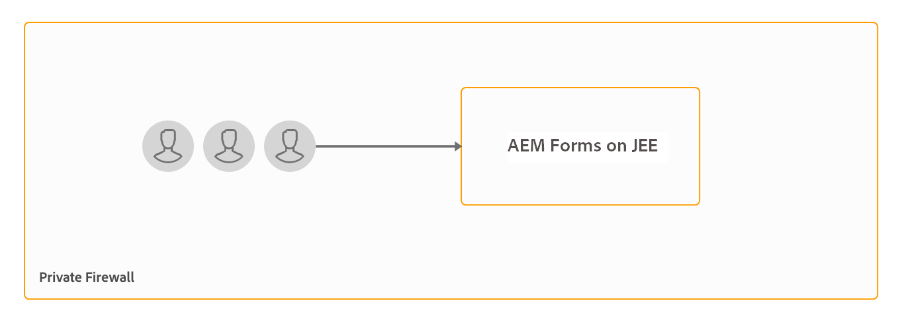
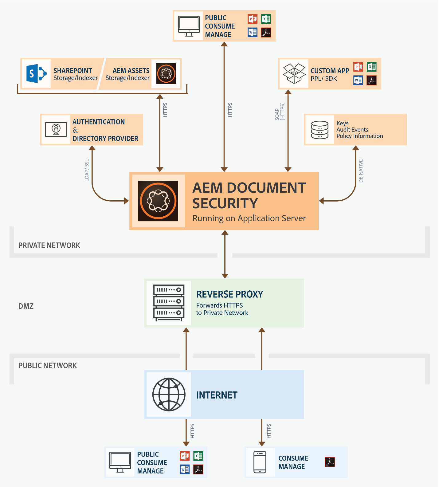

# 安裝和設定Document Security伺服器 {#installing-and-configuring-the-document-security-server}

使用Document Security安全地散發您已以支援格式儲存的任何資訊。 只有授權的使用者才能存取受保護的檔案。

Adobe Experience Manager Forms document security可確保只有授權的使用者才能使用您的檔案。 使用Document Security，您可以安全地散發以支援格式儲存的任何資訊。 支援的檔案格式包括Adobe可攜式檔案格式(PDF)以及Microsoft Word、Excel和PowerPoint檔案。

您可以使用原則來保護檔案。 您在原則中指定的機密性設定可決定收件者如何使用您套用原則的檔案。 例如，您可以指定收件者是否可以列印或複製文字、編輯文字，或新增簽名和註解至受保護檔案。

原則儲存在Document Security伺服器上；您可以透過使用者端應用程式將原則套用至檔案。 當您套用原則至檔案時，原則中指定的機密性設定會保護檔案所包含的資訊。 您可以將受原則保護的檔案分發給受原則授權的收件者。

Document Security還提供使用者端、檢視器和索引器來保護檔案、檢視受保護的檔案以及編制受保護檔案的索引。 如需Document Security的詳細資訊，請參閱[關於Document Security](/help/forms/using/admin-help/document-security.md)。

## 部署拓撲  {#deployment-topology}

Document Security功能僅適用於JEE上的AEM Forms 。 您需要JEE上的單一AEM Forms例項。 如有需要，您也可以建立AEM Forms伺服器的叢集或陣列。 下列拓撲指示執行Document Security功能的拓撲。 如需拓撲的詳細資訊，請參閱[AEM Forms的架構和部署拓撲](aem-forms-architecture-deployment.md)。

<!--fix above link-->

下圖顯示AEM Forms Document Security的典型架構：

## 在JEE上安裝AEM Forms {#installing-aem-forms-on-jee}

執行以下步驟，在JEE上安裝和設定AEM Forms：

1. 從[AEM授權網站(LWS)](https://licensing.adobe.com/)下載JEE安裝程式上的Adobe 6.5 Forms。 您需要有效的維護與支援合約才能下載安裝程式。
1. 閱讀[JEE支援平台上的AEM Forms檔案](/help/forms/using/aem-forms-jee-supported-platforms.md)，並確定軟體、硬體、作業系統、應用程式伺服器、資料庫、JDK和其他基礎架構已準備好在JEE上安裝AEM Forms。
1. （僅限非Turnkey安裝）閱讀[準備安裝AEM Forms單一伺服器](https://www.adobe.com/go/learn_aemforms_prepareInstallsingle_64)或[準備安裝AEM Forms伺服器叢集](https://www.adobe.com/go/learn_aemforms_prepareInstallcluster_64)，並準備讓您的環境在JEE上安裝並設定AEM Forms。
1. 根據您的環境和應用程式伺服器，選擇下列其中一份檔案，然後依照指示完成安裝

   * [使用JBoss整套索引鍵在JEE上安裝和部署AEM Forms](https://www.adobe.com/go/learn_aemforms_installTurnkey_64)
   * [在JEE for JBoss上安裝和部署AEM Forms](https://www.adobe.com/go/learn_aemforms_installJBoss_64)
   * [在JEE for WebLogic上安裝和部署AEM Forms](https://www.adobe.com/go/learn_aemforms_installWebLogic_64)
   * [在JEE for WebSphere上安裝和部署AEM Forms](https://www.adobe.com/go/learn_aemforms_installWebSphere_64)
   * [在JBoss叢集上的JEE上設定AEM Forms](https://www.adobe.com/go/learn_aemforms_clusterJBoss_64)
   * [在WebLogic叢集上的JEE上設定AEM Forms](https://www.adobe.com/go/learn_aemforms_clusterWebLogic_64)
   * [在WebSphere叢集上的JEE上設定AEM Forms](https://www.adobe.com/go/learn_aemforms_clusterWebSphere_64)

   >[!NOTE]
   >
   >在JEE Configuration Manager上AEM Forms的模組選擇畫面上，選擇Document Security選項。 Document Security選項不需要選取任何其他模組。

## 後續步驟 {#next-steps}

* [設定使用者端和伺服器選項](/help/forms/using/admin-help/configuring-client-server-options.md)
* [建立和管理原則](/help/forms/using/admin-help/creating-policies.md)
* [建立和管理原則集](/help/forms/using/admin-help/creating-policy-sets.md)
