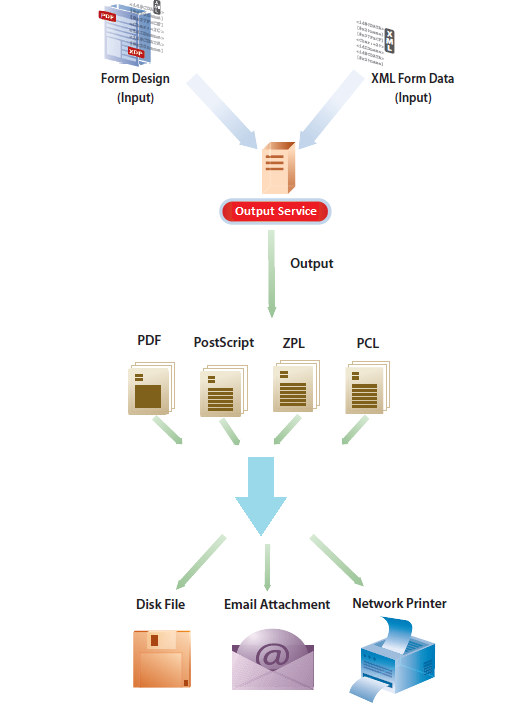

# 輸出服務{#output-service}

## 概觀 {#overview}

Output服務是AEM Document Services中的OSGi服務。 輸出服務支援各種AEM Forms Designer的輸出格式和輸出設計功能。 輸出服務可以轉換XFA範本和XML資料，以產生多種格式的列印檔案。

Output 服務可讓您建立以下用途的應用程式：

* 使用 XML 資料填寫範本檔案來產生最終表單文件。
* 產生多種格式的輸出表單，包括非互動式PDF、PostScript、PCL和ZPL列印資料流。
* 從 XFA 表單 PDF 產生列印 PDF。
* 將多組資料與提供的範本合併，以大量產生PDF、PostScript、PCL和ZPL檔案。

>[!NOTE]
>
>輸出服務是32位元應用程式。 在Microsoft Windows上，32位元應用程式最多可以使用2 GB的記憶體。 此限制也適用於輸出服務。

## 建立非互動式表單檔案 {#creating-non-interactive-form-documents}

通常使用AEM Forms Designer來建立範本。 Output服務的`generatePDFOutput`和`generatePrintedOutput` API可讓您直接將這些範本轉換為各種格式，包括PDF、PostScript、ZPL和PCL。

`generatePDFOutput`作業產生PDF，而`generatePrintedOutput`作業產生PostScript、ZPL和PCL格式。 這兩個操作的第一個引數接受範本檔案的名稱（例如，`ExpenseClaim.xdp`）或包含範本的Document物件。 當您指定範本檔案的名稱時，請將內容根目錄指定為包含範本的資料夾的路徑。 您可以使用`PDFOutputOptions`或`PrintedOutputOptions`引數來指定內容根目錄。 請參閱Javadoc以取得您可以使用這些引數指定之其他選項的詳細資訊。

第二個引數會接受在產生輸出檔案時與範本合併的XML檔案。

`generatePDFOutput`作業也可以接受以XFA為基礎的PDF表單作為輸入，並傳回非互動式版本的PDF表單作為輸出。

## 產生非互動式表單檔案 {#generating-non-interactive-form-documents}

假設您有一或多個範本，且每個範本有多個XML資料記錄。

使用Output服務的`generatePDFOutputBatch`和`generatePrintedOutputBatch`作業，為每個記錄產生列印檔案。

您也可以將記錄合併成單一檔案。 這兩個作業都需使用四個引數。

第一個引數是Map，其中包含作為索引鍵的任意字串，以及作為值的範本檔案名稱。

第二個引數是不同的Map，其值是包含XML資料的Document物件。 此鍵與您為第一個引數指定的鍵相同。

`generatePDFOutputBatch`或`generatePrintedOutputBatch`的第三個引數分別為型別`PDFOutputOptions`或`PrintedOutputOptions`。

引數型別與`generatePDFOutput`和`generatePrintedOutput`作業的引數型別相同，且具有相同的效果。

第四個引數屬於型別`BatchOptions`，您用來指定是否可以為每個記錄產生個別的檔案。 此引數的預設值為false。

`generatePrintedOutputBatch`和`generatePDFOutputBatch`都傳回型別`BatchResult`的值。 值包含產生的檔案清單。 它也會包含XML格式的中繼資料檔案，其中包含與產生的每個檔案相關的資訊。
