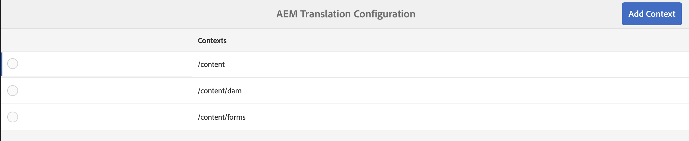
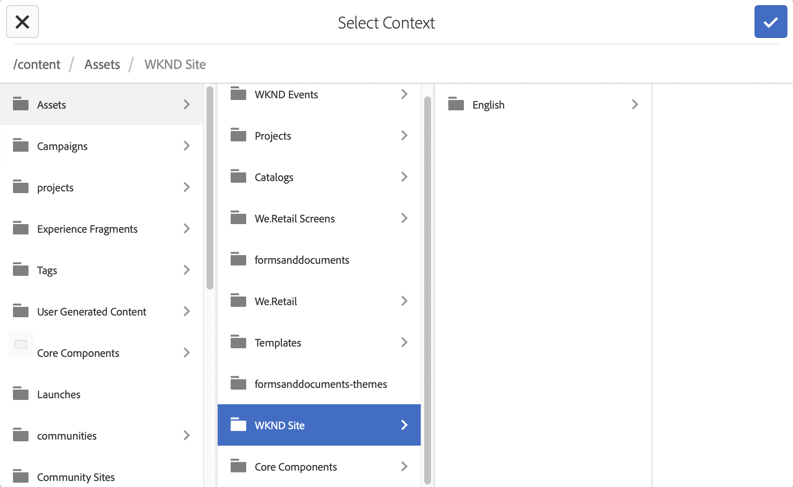
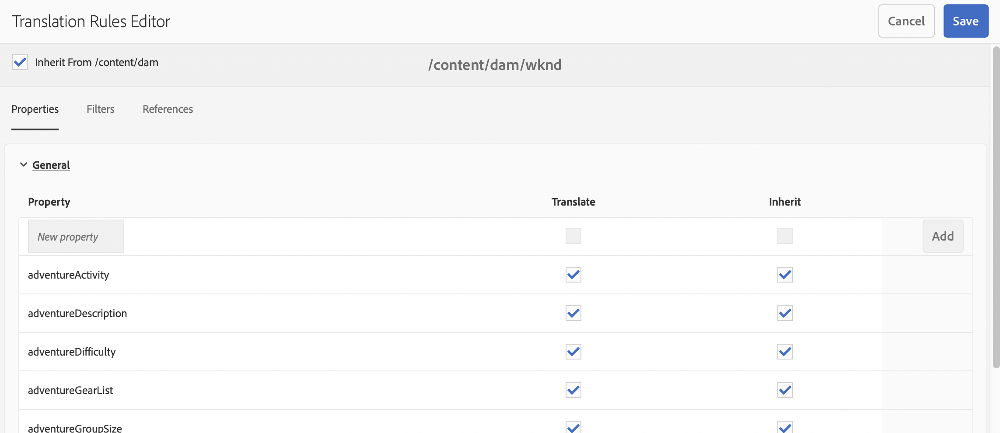
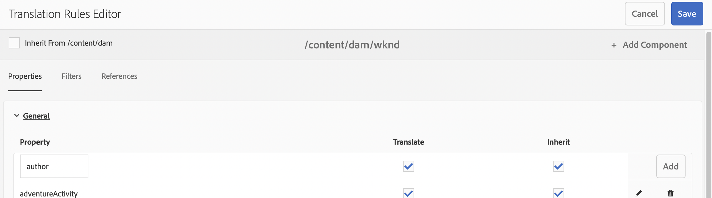

# 設定翻譯規則 {#configure-translation-rules}

了解如何定義翻譯規則以識別要翻譯的內容。

## 目前進度 {#story-so-far}

在 AEM Headless 翻譯歷程的上一份文件「[設定翻譯整合](configure-connector.md)」中，您已了解如何安裝和設定翻譯整合，您現在應該：

* 了解 AEM 中翻譯整合框架的重要參數。
* 能夠為您的翻譯服務設定您自己的連接。

現在您的整合已設定，本文將帶您完成下一步，確定您需要翻譯的內容。

## 目標 {#objective}

本文件協助您了解如何使用 AEM 的翻譯規則來識別您的翻譯內容。 閱讀本文件後，您應該：

* 了解翻譯規則的作用。
* 能夠定義您自己的翻譯規則。

## 翻譯規則 {#translation-rules}

代表 Headless 內容的內容片段可以包含許多依照結構化欄位組織的資訊。 根據您的專案需要，可能並非內容片段中的所有欄位都必須翻譯。

翻譯規則會識別翻譯專案包含的內容或排除的內容。 翻譯內容時，AEM 會根據這些規則擷取或收集內容。 如此，只有必須翻譯的內容才會被傳送到翻譯服務。

翻譯規則包含以下資訊：

* 規則套用到的內容路徑
  * 規則也套用到內容的各個下層項目
* 包含要翻譯之內容的屬性的名稱
  * 該屬性可專屬於特定資源類型或所有資源類型

由於內容片段模型 (用於定義內容片段結構) 對您自己的專案而言是唯一的，因此設定翻譯規則至關重要，這樣 AEM 才能知道要翻譯內容模型的哪些元素。

>[!TIP]
>
>一般而言，內容架構師會為翻譯專家提供翻譯所需的所有欄位的&#x200B;**屬性名稱**。 設定翻譯規則時需要這些名稱。 作為翻譯專家，您可以自己[找到這些&#x200B;**屬性名稱**](getting-started.md#content-models)，如本歷程先前所述。

## 建立翻譯規則 {#creating-rules}

可以建立多個規則來支援複雜的翻譯要求。 例如，您可能正在處理的其中一個專案需要翻譯模型的所有欄位，但另一個專案只需要翻譯描述欄位，標題不需要翻譯。

翻譯規則旨在處理此類情況。 然而，在此範例中，我們著重在單一、簡單的設定，藉此來說明如何建立規則。

可使用&#x200B;**翻譯設定**&#x200B;主控台來設定翻譯規則。 若要存取它：

1. 導覽至「**工具**」>「**一般**」。
1. 按一下&#x200B;**翻譯組態**。

在「**翻譯設定**」UI 中，有數個選項可用於您的翻譯規則。 在這裡，我們強調基本 Headless 本地化設定所需的最需要和典型的步驟。

1. 按一下&#x200B;**新增內容**，讓您新增路徑。 這是受規則影響的內容的路徑。
   
1. 使用路徑瀏覽器選取所需的路徑，然後按一下&#x200B;**確認**&#x200B;按鈕以儲存。 請記住，內容片段 (其包含 Headless 內容) 通常位於 `/content/dam/<your-project>` 下。
   
1. AEM 儲存設定。
1. 選取您建立的內容，然後按一下[編輯]。**&#x200B;** 這將開啟&#x200B;**翻譯規則編輯器** 以設定屬性。
   
1. 依預設，所有設定都繼承自父路徑，在此案例中為 `/content/dam`。 取消核取選項&#x200B;**從`/content/dam`**&#x200B;繼承以新增其他欄位到組態。
1. 取消勾選後，在清單的&#x200B;**一般**&#x200B;部分下，新增您[先前識別為翻譯欄位](getting-started.md#content-models)之內容片段模型的屬性名稱。
   1. 在&#x200B;**新屬性**&#x200B;欄位中輸入屬性名稱。
   1. 選項&#x200B;**翻譯**&#x200B;和&#x200B;**繼承**&#x200B;會自動勾選。
   1. 按一下&#x200B;**「新增」**。
   1. 對必須翻譯的所有欄位重複這些步驟。
   1. 按一下&#x200B;**儲存**。
      

您現在已經設定翻譯規則。

## 進階用法 {#advanced-usage}

有數個其他屬性可以設定為翻譯規則的一部分。 此外，您可以手動以 XML 指定規則，這樣可提供更高的明確性和靈活性。

開始本地化 Headless 內容通常不需要此類功能，但如果您有興趣，可以在[其他資源](#additional-resources)區段深入了解。

## 下一步 {#what-is-next}

您已完成 Headless 翻譯歷程的此部分，您應該：

* 了解翻譯規則的作用。
* 能夠定義您自己的翻譯規則。

以這些知識為基礎，接下來查看文件[翻譯內容](translate-content.md)以繼續您的 AEM Headless 翻譯歷程，您將在此文件了解整合和規則如何搭配運作以翻譯 Headless 內容。

## 其他資源 {#additional-resources}

雖然建議您檢閱文件「[翻譯內容](translate-content.md)」以繼續 Headless 翻譯歷程的下一部分，但下列是一些其他選用資源，深入探究了本文件提到的一些概念，不過這些資源並非繼續 Headless 歷程的必要條件。

* [識別要翻譯的內容](/help/sites-administering/tc-rules.md) - 了解翻譯規則如何識別需要翻譯的內容。
