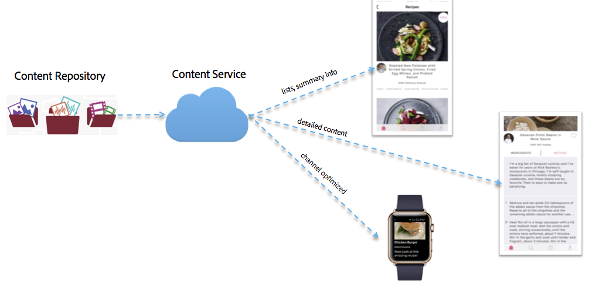

# 內容服務{#content-services}

{{ue-over-mobile}}

>[!CAUTION]
>
>Content Services功能僅供預覽之用。
>
>此版本可能會隨著6.3 Service Pack 1發行而有所變更。

AEM Mobile Content Services是輕量級的功能，可請求由AEM管理的內容。 這可讓所有應用程式開發人員不需要深入瞭解AEM的內容存放庫(JCR)和網頁架構(Sling)，就能以高效能的方式擷取內容。 這可讓請求的應用程式與內容存放庫分離。

Content Services匯入了數種新的AEM建構，讓開發人員可直接存取AEM管理的內容，而不需瞭解該內容的存放庫結構。

這些建構對於在AEM管理的內容和使用內容的行動應用程式之間提供抽象層，以保持靈活性並啟用未來擴充是必要的。 這可讓AEM Content Services在原生應用程式的內容需求與AEM內容存放庫之間，以抽象層的形式運作。

Content Services可將內容以資產、封裝的HTML (HTML/CSS/JS)或不受通道影響的內容來傳送。

>[!CAUTION]
>
>**必要條件：**
>
>開始使用內容服務前，請務必啟用「內容服務」標幟。 若要啟用應用程式中模型的建立和管理，請在設定瀏覽器中啟用資料模型。
>
>如需詳細資訊，請參閱&#x200B;**[管理內容服務](/help/mobile/developing-content-services.md)**&#x200B;和[設定瀏覽器](/help/sites-administering/configurations.md)檔案。

設定Content Services標幟並在設定瀏覽器中啟用資料模型後，請參閱下列資源以開始使用AEM Mobile Content Services。 熟悉內容服務概念，例如模型管理、實體管理，然後是AEM Mobile Content Services的內容傳送/呈現。

* 存放庫中的模型
* 呈現和傳遞
