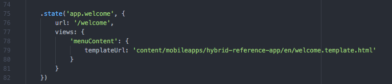
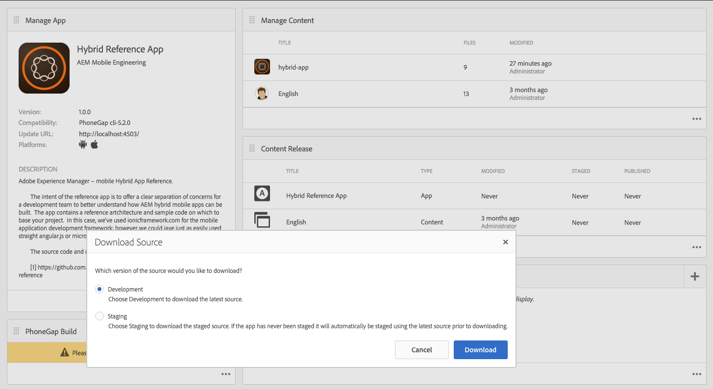

# 您的混合式應用程式是否已準備好使用Adobe Experience Manager Mobile？{#is-your-hybrid-app-ready-for-aem-mobile}

{{ue-over-mobile}}

您已將混合式PhoneGap或Cordova應用程式匯入AEM，現在該怎麼做？ 您可能會想要將可編寫的內容新增至應用程式。 若要完成此工作，您必須大致瞭解AEM應用程式的結構。 AEM中的應用程式通常分為兩個部分。 「殼層」和「內容」。 「殼層」包含應用程式的靜態部分；例如PhoneGap設定檔案、應用程式架構和導覽控制項。 您匯入的歸檔內容會儲存為殼的一部分。 在此檔案的內容中，殼層是應用程式開發人員建立的混合PhoneGap應用程式的所有非AEM編寫內容。

內容是指在AEM中由AEM開發人員建立的元件、範本和編寫頁面。 內容可歸類為開發人員內容或編寫內容。 元件、設計和頁面範本被視為開發內容，因為它們是由開發人員建置。 作者內容是使用元件和範本建立的頁面。 這些頁面通常由Designer或行銷人員完成。

將編寫的AEM頁面新增至您的混合式應用程式，需要應用程式開發人員和AEM開發人員之間的協調。 應用程式中，只要您希望新增編寫內容，開發人員都必須在Experience Manager中以可重疊的結構組織這些頁面。 應用程式開發人員必須能向Experience Manager開發人員提供新增Experience Manager編寫內容的路徑。 然後，在混合應用程式中提供預留位置頁面，此頁面會在Experience Manager開發人員編寫頁面內容後取代。

為了讓說明更易於遵循，現正使用AEM Experience Cloud： AEM Mobile混合參考來說明概念。 混合式參考應用程式包含歡迎頁面和側邊功能表。

在此範例中，將會編寫應用程式的歡迎頁面。 正在檢視來源[https://github.com/Adobe-Marketing-Cloud-Apps/aem-mobile-hybrid-reference/blob/master/hybrid-app/www/js/app.js#L75](https://github.com/Adobe-Marketing-Cloud-Apps/aem-mobile-hybrid-reference/blob/master/hybrid-app/www/js/app.js#L75)。 請注意，應用程式開發人員已定義歡迎頁面，並提供應用程式轉譯之頁面的範本。 此頁面是應用程式開發人員和AEM開發人員必須協調的位置。 混合參考應用程式中歡迎頁面範本的路徑定義為「content/mobileapps/hybrid-reference-app/en/welcome.template.html」。 此路徑很重要，因為AEM開發人員將使用相同的路徑，在AEM存放庫中編寫其歡迎頁面。

混合式應用程式和AEM編寫內容使用相同路徑很重要，因為這有賴使用Content Sync覆蓋內容的功能，以將新頁面新增至混合式應用程式。 當混合式應用程式匯入AEM時（匯入程式的一部分），系統會設定Content Sync設定。

當您從應用程式控制面板「下載Source」時，這些ContentSync指令碼會執行，以組合混合式應用程式的封存。

ContentSync會先提取應用程式的「殼層」，此為混合式應用程式所有應用程式開發內容的儲存位置。 接著，系統會提取應用程式的「內容」。 現在，如果「shell」中有與「content」具有相同路徑的頁面，則「shell」下的頁面會被「content」下的頁面（取代）了。 因此，在混合參考應用程式範例中，如果在AEM中建立的頁面具有與「content/mobileapps/hybrid-reference-app/en/welcome.template.html」相同的路徑，當ContentSync執行時，它會覆蓋屬於混合參考應用程式一部分的頁面。 它會以該位置的AEM中的任何內容加以覆蓋。 覆蓋由ContentSync處理，因此對於使用應用程式的使用者而言，使用AEM編寫內容更新應用程式看起來會很順暢，不需要重建應用程式。 因此，當您執行應用程式時，歡迎頁面會如下所示：

