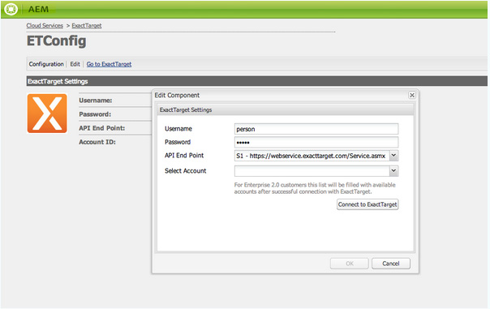
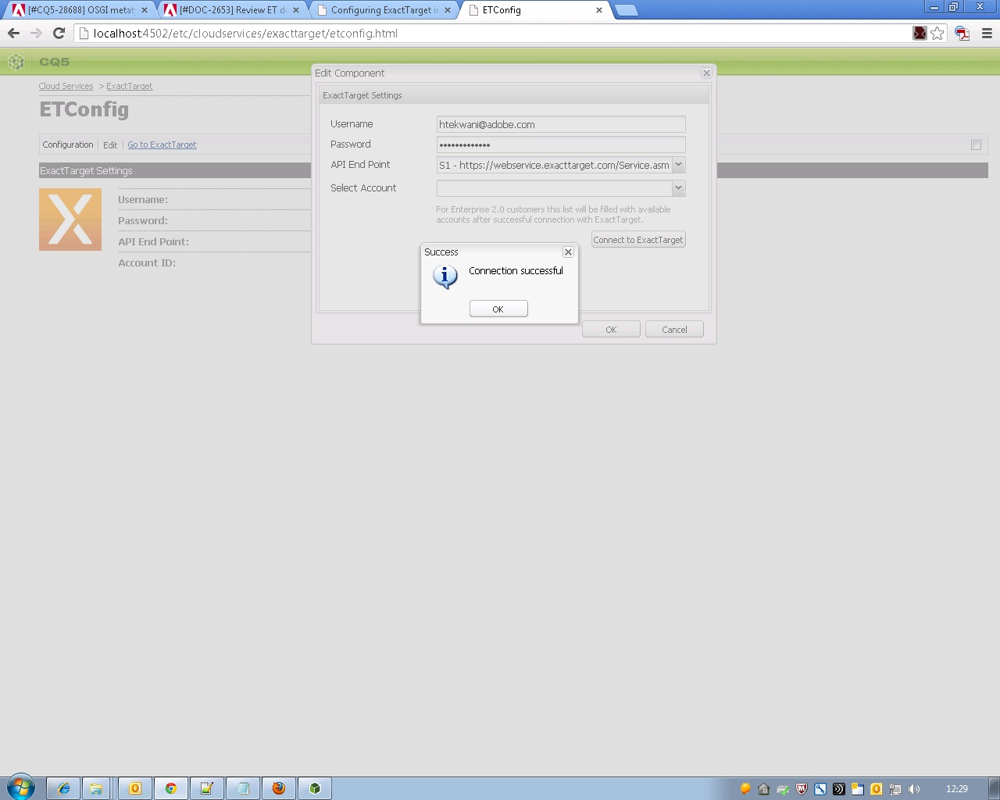

# 與ExactTarget整合{#integrating-with-exacttarget}

將Adobe Experience Manager (AEM)與Exact Target整合可讓您透過Exact Target管理並傳送AEM中建立的電子郵件。 它也可讓您透過AEM頁面上的AEM表單，使用Exact Target的銷售機會管理功能。

整合提供您下列功能：

* 能夠在AEM中建立電子郵件，並將其發佈到Exact Target中分發。
* 能夠設定AEM表單的動作以建立Exact Target訂閱者。

設定ExactTarget後，您可以將電子報或電子郵件發佈至ExactTarget。 請參閱[將電子報發佈至電子郵件服務](/help/sites-authoring/personalization.md)。

## 建立ExactTarget組態 {#creating-an-exacttarget-configuration}

您可以透過Cloudservices或Tools新增ExactTarget設定。 本節將說明這兩種方法。

### 透過Cloudservices設定ExactTarget {#configuring-exacttarget-via-cloudservices}

若要在雲端服務中建立ExactTarget設定：

1. 在歡迎頁面上，按一下&#x200B;**雲端服務**。 （或直接在`https://<hostname>:<port>/etc/cloudservices.html`存取。）
1. 按一下&#x200B;**ExactTarget**，然後按一下&#x200B;**設定**。 ExactTarget組態視窗會開啟。

   

1. 輸入標題，並選擇性地輸入名稱，然後按一下&#x200B;**建立**。 **ExactTarget設定**&#x200B;組態視窗會開啟。

   

1. 輸入使用者名稱、密碼，然後選取API端點（例如，**https://webservice.exacttarget.com/Service.asmx**）。
1. 按一下&#x200B;**連線到ExactTarget。** 成功連線後，您會看到成功對話方塊。 方塊按一下&#x200B;**確定**&#x200B;以結束視窗。

   

1. 選取帳戶（如果可用）。 此帳戶適用於Enterprise 2.0客戶。 按一下&#x200B;**「確定」**。

   已設定ExactTarget。 您可以按一下&#x200B;**編輯**&#x200B;來編輯組態。 您可以按一下&#x200B;**移至ExactTarget**，移至ExactTarget。

1. AEM現在提供資料擴充功能功能。 您可以匯入ExactTarget資料延伸模組欄。 除了已成功建立的ExactTarget設定外，按一下「+」符號即可進行設定。 您可從下拉式清單中選取任何現有的資料擴充功能。 如需如何設定資料擴充功能的詳細資訊，請參閱[ExactTarget檔案](https://help.salesforce.com/s/articleView?id=sf.mc_es_data_extension_data_relationships_classic.htm&type=5)。

   匯入的資料延伸欄稍後可透過&#x200B;**文字和Personalization**&#x200B;元件使用。

   

### 透過工具設定ExactTarget {#configuring-exacttarget-via-tools}

若要在工具中建立ExactTarget組態：

1. 在歡迎頁面上，按一下&#x200B;**工具**。 或前往`https://<hostname>:<port>/misadmin#/etc`直接導覽至該處。
1. 依序選取&#x200B;**工具**、**雲端服務設定、**&#x200B;和&#x200B;**ExactTarget**。
1. 按一下&#x200B;**新增**&#x200B;以開啟&#x200B;**建立頁面**&#x200B;視窗。

   

1. 輸入&#x200B;**Title**，並選擇性地輸入&#x200B;**Name**，然後按一下&#x200B;**建立**。
1. 依照前一個程式中的步驟4輸入組態資訊。 請依照該程式完成設定ExactTarget。

### 新增多個組態 {#adding-multiple-configurations}

若要新增多個組態：

1. 在歡迎頁面上，按一下&#x200B;**雲端服務**&#x200B;並按一下&#x200B;**ExactTarget**。 按一下&#x200B;**顯示組態**，如果有一或多個ExactTarget組態可用，就會顯示此組態。 列出所有可用的設定。
1. 按一下「可用組態」旁的&#x200B;**+**&#x200B;符號。 這會開啟&#x200B;**建立組態**&#x200B;視窗。 請依照之前的組態程式來建立組態。
