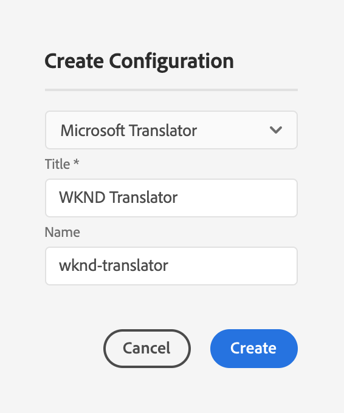
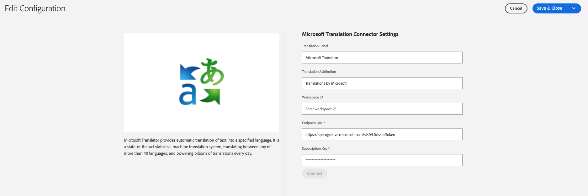

# 連線到 Microsoft Translator {#connecting-to-microsoft-translator}

AEM為[Microsoft Translator](https://www.microsoft.com/en-us/translator/business/)提供內建聯結器，用於翻譯頁面內容或資產。 從Microsoft取得使用Microsoft Translator的授權後，請依照本頁面上的指示設定聯結器。

| 屬性 | 說明 |
|---|---|
| 翻譯標籤 | 翻譯服務的顯示名稱 |
| 翻譯屬性 | （選用）對於使用者產生的內容，為已翻譯文字旁邊顯示的屬性，例如`Translations by Microsoft` |
| 工作區 ID | （選用）要使用的自訂Microsoft Translator引擎識別碼 |
| 訂閱金鑰 | 您的Microsoft Translator Microsoft訂閱金鑰 |

下列程式會建立Microsoft Translator設定。

1. 在[導覽面板中，](/help/sites-authoring/basic-handling.md#first-steps)按一下&#x200B;**工具** > **雲端服務** > **翻譯雲端服務**。
1. 導覽至您要建立設定的位置。 這通常位於您的網站根目錄中，或可為全域預設設定。
1. 按一下&#x200B;**建立**&#x200B;按鈕。
1. 定義您的設定。
   1. 下拉式清單中的Select **Microsoft翻譯工具**。
   1. 輸入設定的標題。 標題會識別雲端服務主控台和頁面屬性下拉式清單中的設定。
   1. 選擇性地輸入儲存組態之儲存庫節點的名稱。

   

1. 按一下「**建立**」。
1. 在&#x200B;**編輯組態**&#x200B;視窗中，提供上一個表格所述之翻譯服務的值。

   

1. 按一下&#x200B;**連線**&#x200B;以驗證連線。
1. 按一下「**儲存並關閉**」。

## 發佈Translator服務設定 {#publishing-the-translator-service-configurations}

最後一個步驟，請使用[發佈樹狀結構](/help/sites-authoring/publishing-pages.md#publishing-and-unpublishing-a-tree)動作，發佈您的Microsoft Translator設定，以支援已發佈的翻譯內容。

## Microsoft Translator API欄位對應 {#microsoft-translator-api-field-mapping}

Microsoft Translator API v3接受位於`https://api.cognitive.microsofttranslator.com/translate?api-version=3.0`的翻譯要求。 請參閱[Microsoft Translate API參考資料](https://learn.microsoft.com/en-us/azure/ai-services/translator/text-translation/reference/v3/translate)以取得必要的引數，包括目標語言。

下表說明AEM設定欄位與Microsoft API的相關性。

| AEM欄位 | AEM中的用途 | Microsoft API關係 |
|---|---|---|
| 工作區 ID | 識別要使用的自訂Microsoft翻譯器引擎。 | 透過`category`要求引數選取自訂翻譯系統。 Microsoft的API需要自訂翻譯人員類別ID，而非單獨的工作區ID。 確認您的聯結器和自訂模型設定所需的值。 |
| 翻譯標籤 | 提供翻譯服務的顯示名稱。 | 沒有對應的翻譯請求引數。 |
| 翻譯屬性 | 定義翻譯的使用者產生內容旁的選用歸因。 | 沒有對應的翻譯請求引數。 |
| 訂閱金鑰 | 驗證Microsoft Translator訂閱的存取權。 | 要求存取權杖時在`Ocp-Apim-Subscription-Key`標頭中傳送。 然後，該權杖會在翻譯請求的`Authorization: Bearer <access-token>`標頭中傳送。 |

對於全域Microsoft Translator資源，權杖端點為`https://api.cognitive.microsoft.com/sts/v1.0/issueToken`。 區域和多服務資源會使用區域特定的Token端點。 如需資源型別的端點與標頭需求，請參閱[Microsoft Translator驗證](https://learn.microsoft.com/en-us/azure/ai-services/translator/text-translation/reference/authentication)。
