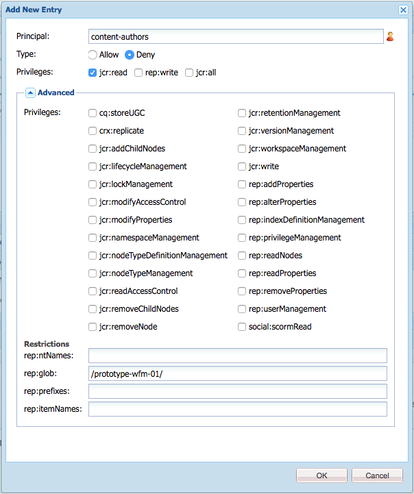
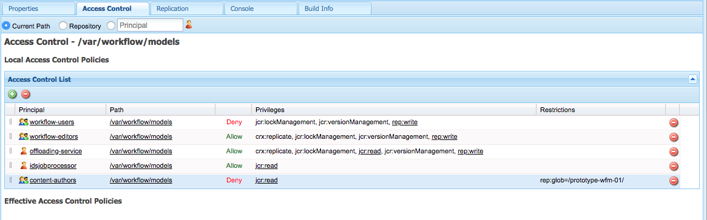
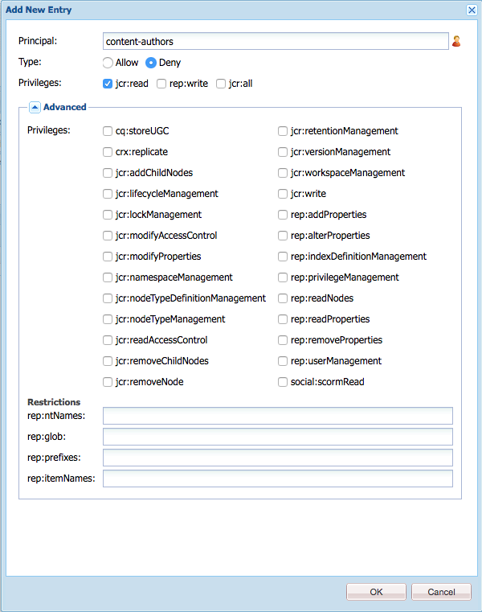
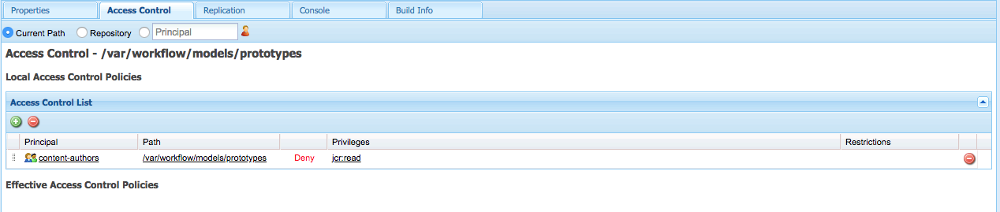

# 管理工作流程存取權{#managing-access-to-workflows}

根據使用者帳戶設定ACL以允許（或停用）啟動和參與工作流程。

## 工作流程的必要使用者許可權 {#required-user-permissions-for-workflows}

在下列情況下，可以對工作流程採取行動：

* 您正在使用`admin`帳戶
* 帳戶已指派給預設群組`workflow-users`：

  * 此群組擁有您的使用者執行工作流程動作所需的所有許可權。
  * 當帳戶在此群組中時，它只能存取其已起始的工作流程。

* 帳戶已指派給預設群組`workflow-administrators`：

  * 此群組擁有授權使用者監視和管理工作流程所需的所有許可權。
  * 當帳戶在此群組中時，它可以存取所有工作流程。

>[!NOTE]
>
>這些是最低需求。 您的帳戶也必須是受指派的參與者或受指派群組的成員，才能執行特定步驟。

## 設定工作流程的存取權 {#configuring-access-to-workflows}

工作流程模型會繼承預設存取控制清單(ACL)，以控制使用者與工作流程互動的方式。 若要自訂工作流程的使用者存取，請修改包含工作流程模型節點之資料夾的存放庫中的「存取控制清單(ACL)」：

* [將特定工作流程模型的ACL套用至/var/workflow/models](/help/sites-administering/workflows-managing.md#apply-an-acl-for-the-specific-workflow-model-to-var-workflow-models)
* [在/var/workflow/models中建立子資料夾，並將ACL套用至該子資料夾](/help/sites-administering/workflows-managing.md#create-a-subfolder-in-var-workflow-models-and-apply-the-acl-to-that)

>[!NOTE]
>
>如需使用CRXDE Lite設定ACL的詳細資訊，請參閱[存取許可權管理](/help/sites-administering/user-group-ac-admin.md#access-right-management)。

### 將特定工作流程模型的ACL套用至/var/workflow/models {#apply-an-acl-for-the-specific-workflow-model-to-var-workflow-models}

如果工作流程模型儲存在`/var/workflow/models`中，則您可以在資料夾中指派特定ACL （僅與該工作流程相關）：

1. 在網頁瀏覽器中開啟CRXDE Lite （例如，[http://localhost:4502/crx/de](http://localhost:4502/crx/de)）。
1. 在節點樹狀結構中，選取工作流程模型資料夾的節點：

   `/var/workflow/models`

1. 按一下「**存取控制**」標籤。
1. 在&#x200B;**本機存取控制原則** （**存取控制清單**）表格中，按一下加號圖示以&#x200B;**新增專案**。
1. 在&#x200B;**新增專案**&#x200B;對話方塊中，新增具有以下屬性的ACE：

   * **主體**： `content-authors`
   * **類型**：`Deny`
   * **許可權**： `jcr:read`
   * **rep:glob**：參考特定工作流程

   

   **存取控制清單**&#x200B;表格現在包含`prototype-wfm-01`工作流程模型上`content-authors`的限制。

   

1. 按一下&#x200B;**「儲存全部」**。

   `content-authors`群組的成員無法再使用`prototype-wfm-01`工作流程。

### 在/var/workflow/models中建立子資料夾，並將ACL套用至該子資料夾 {#create-a-subfolder-in-var-workflow-models-and-apply-the-acl-to-that}

您的[開發團隊可以在的子資料夾](/help/sites-developing/workflows-models.md#creating-a-new-workflow)中建立工作流程

`/var/workflow/models`

與儲存在下的DAM工作流程比較

`/var/workflow/models/dam/`

然後，您可以將ACL新增至資料夾本身。

1. 在網頁瀏覽器中開啟CRXDE Lite （例如，[http://localhost:4502/crx/de](http://localhost:4502/crx/de)）。
1. 在節點樹狀結構中，選取工作流程模型資料夾中個別資料夾的節點；例如：

   `/var/workflow/models/prototypes`

1. 按一下「**存取控制**」標籤。
1. 在&#x200B;**適用的存取控制原則**&#x200B;表格中，按一下加號圖示以&#x200B;**新增**&#x200B;專案。
1. 在&#x200B;**本機存取控制原則** （**存取控制清單**）表格中，按一下加號圖示以&#x200B;**新增專案**。
1. 在&#x200B;**新增專案**&#x200B;對話方塊中，新增具有以下屬性的ACE：

   * **主體**： `content-authors`
   * **類型**：`Deny`
   * **許可權**： `jcr:read`

   >[!NOTE]
   >
   >與[套用特定工作流程模型的ACL至/var/workflow/models](/help/sites-administering/workflows-managing.md#apply-an-acl-for-the-specific-workflow-model-to-var-workflow-models)一樣，您可以包含rep:glob以限制特定工作流程的存取權。

   

   **存取控制清單**&#x200B;資料表現在包含`prototypes`資料夾上`content-authors`的限制。

   

1. 按一下&#x200B;**「儲存全部」**。

   `prototypes`資料夾中的模型已不適用於`content-authors`群組的成員。
