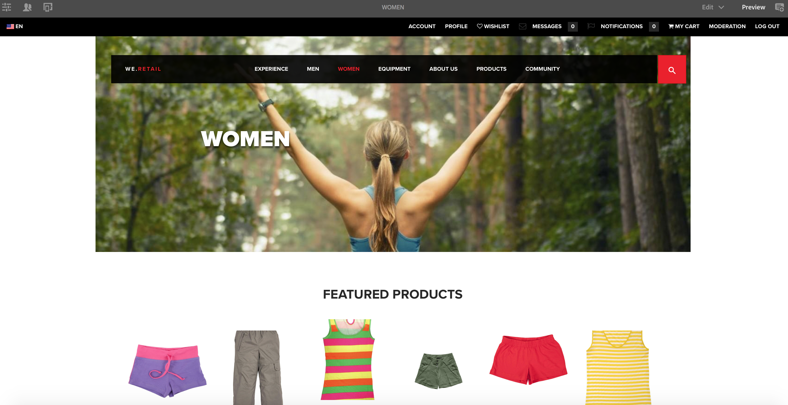

# 為行動裝置編寫頁面{#authoring-a-page-for-mobile-devices}

編寫行動頁面時，頁面會以模擬行動裝置的方式顯示。 編寫頁面時，您可以在多個模擬器之間切換，以檢視一般使用者在存取頁面時看到的內容。

系統會根據裝置轉譯頁面的功能，將裝置分組為類別功能、智慧型和觸控。 當一般使用者存取行動頁面時，AEM會偵測裝置並傳送與其裝置群組相對應的表現。

>[!NOTE]
>
>若要根據現有標準網站建立行動網站，請建立標準網站的即時副本。 （請參閱[建立不同頻道的即時副本](/help/sites-administering/msm-livecopy.md)。）
>
>AEM開發人員可以建立新的裝置群組。 （請參閱[建立裝置群組篩選器](/help/sites-developing/groupfilters.md)。）

請使用下列程式來編寫行動頁面：

1. 從全域導覽開啟&#x200B;**網站**&#x200B;主控台。
1. 開啟頁面&#x200B;**We.Retail** > **美國** > **英文**。

1. 切換至&#x200B;**預覽**&#x200B;模式。
1. 按一下頁面頂端的裝置圖示，切換至所需的模擬器。
1. 將元件從元件瀏覽器拖放至頁面。

此頁面外觀類似下列內容：

>[!NOTE]
>
>從行動裝置請求製作執行個體上的頁面時，會停用模擬器。
