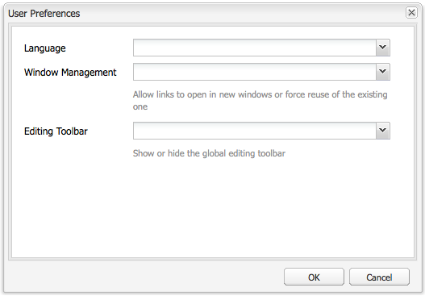

# 設定帳戶環境{#configuring-your-account-environment}

Adobe Experience Manager (AEM)可讓您設定帳戶及製作環境的特定方面。

使用[帳戶設定](#account-settings)和[使用者偏好設定](#user-preferences)，可以定義下列選項和偏好設定：

* **編輯工具列**
選取您是否想要擁有全域編輯工具列。 這個工具列顯示在瀏覽器視窗的頂端，提供您**複製**、**剪下**、**貼上**、**刪除**&#x200B;用於該頁面段落元件的按鈕：

  * 需要時顯示 (預設)
  * 永遠顯示
  * 保持隱藏

* **模擬為**
[模擬為](/help/sites-administering/security.md#impersonating-another-user)的功能可讓使用者代表其他使用者工作。

* **語言**
用於編寫環境UI的語言。 從可用清單中選取所需的語言。

* **視窗管理**
選取：

  * 多視窗 (預設)
    頁面會在新視窗中開啟。
  * 單一視窗
    頁面會在目前視窗中開啟。

## 帳戶設定 {#account-settings}

使用者圖示可讓您存取以下選項：

* 登出
* [模擬為](/help/sites-administering/security.md#impersonating-another-user)
* [使用者偏好設定](#user-preferences)
* [通知收件匣](/help/sites-classic-ui-authoring/author-env-inbox.md)

### 使用者偏好設定 {#user-preferences}

每個使用者都可以為自己設定某些屬性。 可在控制檯右上角的&#x200B;**偏好設定**&#x200B;對話方塊中取得此設定。

此對話方塊提供下列選項：

