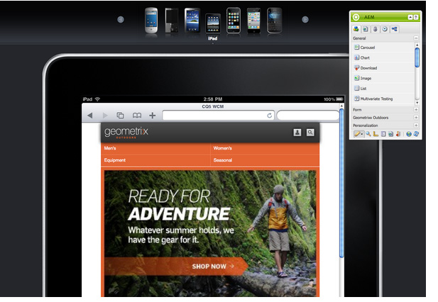

# 為行動裝置編寫頁面{#authoring-a-page-for-mobile-devices}

編寫行動頁面時，頁面會以模擬行動裝置的方式顯示。 編寫頁面時，您可以在多個模擬器之間切換，以檢視一般使用者在存取頁面時看到的內容。

系統會根據裝置轉譯頁面的功能，將裝置分組為類別功能、智慧型和觸控。 當一般使用者存取行動頁面時，AEM會偵測裝置並傳送與其裝置群組相對應的表現。

>[!NOTE]
>
>若要根據現有標準網站建立行動網站，請建立標準網站的即時副本。 （請參閱[建立不同頻道的即時副本](/help/sites-administering/msm-livecopy.md)。）
>
>AEM開發人員可以建立新的裝置群組。 （請參閱[建立裝置群組篩選器。](/help/sites-developing/groupfilters.md)）

請使用下列程式來編寫行動頁面：

1. 在您的瀏覽器中，移至&#x200B;**Siteadmin**&#x200B;主控台。
1. 開啟&#x200B;**網站** >> **Geometrixx Mobile示範網站** >> **英文**&#x200B;下方的&#x200B;**產品**&#x200B;頁面。

1. 切換到不同的模擬器。 若要這麼做，您可以：

   * 按一下頁面頂端的裝置圖示。
   * 按一下&#x200B;**Sidekick**&#x200B;中的&#x200B;**編輯**&#x200B;按鈕，然後在下拉式選單中選取裝置。

1. 將&#x200B;**文字與影像**&#x200B;元件從Sidekick的「行動」標籤拖放至頁面。
1. 編輯元件並新增一些文字。 按一下&#x200B;**確定**&#x200B;以儲存變更。

此頁面看起來與以下專案相同：

>[!NOTE]
>
>從行動裝置請求製作執行個體上的頁面時，會停用模擬器。 接著，您就可以使用觸控式UI完成製作。
