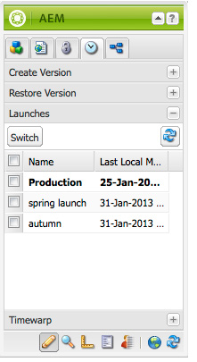

# 編輯啟動{#editing-launches}

## 編輯啟動頁面 {#editing-launch-pages}

為某個頁面（或一組頁面）建立啟動後，您可以在頁面的啟動副本中編輯內容。

1. 開啟頁面以進行編輯。
1. 在Sidekick中，選取&#x200B;**版本設定**&#x200B;標籤，然後展開&#x200B;**啟動**&#x200B;群組。 目前正在編輯的啟動項標題會使用粗體字型。

   

1. 選取您要處理的啟動，然後按一下[切換]。**&#x200B;**
1. 開始編輯。

   >[!NOTE]
   >
   >您可以使用sidekick的&#x200B;**Page**&#x200B;索引標籤來執行&#x200B;**建立子頁面**&#x200B;等動作。

## 編輯啟動設定 {#editing-a-launch-configuration}

建立啟動後，您可以變更啟動名稱和啟動日期。 您也可以指定要與啟動建立關聯的影像。

1. 開啟啟動管理頁面([http://localhost:4502/libs/launches/content/admin.html](http://localhost:4502/libs/launches/content/admin.html))。

1. 選取必要的啟動項，然後按一下&#x200B;**編輯**&#x200B;以開啟對話方塊：

   * 在&#x200B;**一般**&#x200B;標籤中，您可以編輯：

     * **標題**
     * **上線日期**：這等於啟動日期
     * **生產就緒**

     如需這些欄位的用途和互動相關資訊，請參閱[啟動 — 事件順序](/help/sites-authoring/launches.md#launches-the-order-of-events)。

   * 在&#x200B;**影像**&#x200B;索引標籤中，您可以上傳影像檔案。

1. 按一下&#x200B;**儲存**。

## 探索頁面的啟動狀態 {#discovering-the-launch-status-of-a-page}

當您編輯頁面的啟動項時，啟動項的相關資訊會顯示在Sidekick的&#x200B;**版本設定**&#x200B;標籤底部：

* 啟動項的名稱。
* 上次變更後的時間。
* 執行上次變更的使用者。
* **生產就緒**&#x200B;旗標的狀態（橘色=未設定；綠色=設定）。

