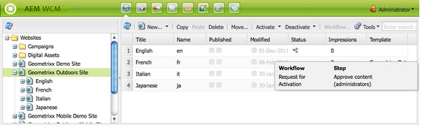
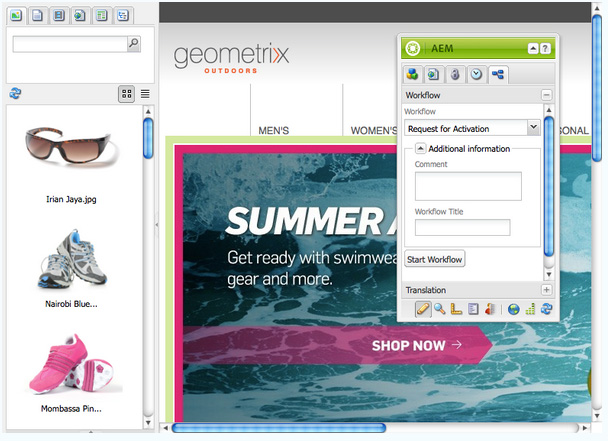

# 將工作流程套用至頁面{#applying-workflows-to-pages}

套用工作流程時，請指定下列資訊：

* 要套用的工作流程。

  您可以套用您有權存取的任何工作流程 (由AEM管理員指派)。
* 選擇性：

  * 提供啟動工作流程原因相關資訊的註解。
  * 有助於識別使用者收件匣中工作流程例項的標題。

>[!NOTE]
>
>AEM管理員可使用[數個其他方法](/help/sites-administering/workflows-starting.md)來開始工作流程。

## 套用工作流程 {#applying-workflows}

工作流程可從「網站」主控台啟動，或編輯頁面時，也可從Sidekick啟動。

**網站**&#x200B;主控台中的&#x200B;**狀態**&#x200B;資料行指出工作流程是否已套用至頁面：

### 從網站主控台啟動工作流程 {#starting-a-workflow-from-the-websites-console}

1. 開啟網站主控台。 ([http://localhost:4502/siteadmin](http://localhost:4502/siteadmin))
1. 在「網站」樹狀結構中，選取您要套用工作流程的頁面的父頁面。
1. 在頁面清單中，選取頁面，然後按一下「工作流程」。
1. 在「開始工作流程」對話方塊中，選取要套用的工作流程。 或者，輸入評論和標題。 然後，按一下「開始」。

### 使用Sidekick啟動工作流程 {#starting-a-workflow-using-sidekick}

1. 開啟網站主控台。
1. 開啟必要頁面。
1. 從Sidekick中選取「工作流程」標籤。
1. 展開&#x200B;**工作流程**&#x200B;對話方塊，讓您選取&#x200B;**工作流程**，並選擇性地輸入&#x200B;**工作流程標題**&#x200B;和&#x200B;**註解**。

   

1. 按一下&#x200B;**啟動工作流程**&#x200B;以啟動新的工作流程執行個體，其中包含您設定的屬性以及目前頁面作為裝載。 現在工作流程正在執行中。
