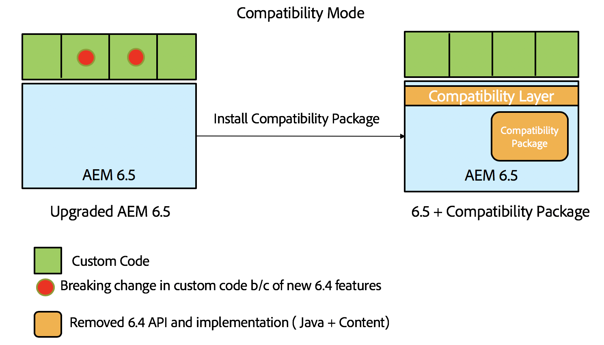
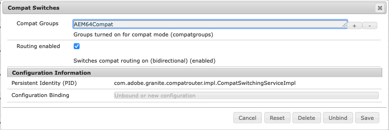

# AEM 6.5的回溯相容性{#backward-compatibility-in-aem}

## 概觀 {#overview}

>[!NOTE]
>
>如需不在相容性套件範圍內的內容和設定變更清單，請參閱[AEM中的存放庫重組](/help/sites-deploying/repository-restructuring.md)。

在Adobe Experience Manager (AEM) 6.5中，開發所有功能時都考慮到回溯相容性。

通常，執行AEM 6.3的客戶在升級時不必變更程式碼或自訂。 對於AEM 6.1和6.2客戶，在升級至6.3期間不會面臨額外的重大變更。

對於無法保持回溯相容功能的例外情況，可以緩解套件組合和內容的回溯不相容問題。 若要這麼做，請安裝6.4的相容性套件（請參閱如何設定以取得下載位置的詳細資訊）。 此相容性套件通常可協助還原與AEM 6.4相容之應用程式的相容性。

相容性套件可讓您以相容性模式執行AEM，並延遲針對新AEM功能的自訂開發：

>[!NOTE]
>
>相容性套件只是暫時性解決方案，可延遲與AEM 6.5相容所需的開發。 只有在升級後無法立即透過開發解決相容性問題時，Adobe才建議將此作為最後選項。 此外，Adobe建議您切換到原生模式，並在決定繼續進行6.5版本的自訂開發並享用6.5版本的完整功能後，解除安裝相容性套件。

相容性套件有兩種模式： **啟用路由**&#x200B;和&#x200B;**停用路由**。

這可讓AEM 6.5以三種模式執行：

**原生模式：**

原生模式適用於想要使用AEM 6.5的所有新功能，並準備好進行一些開發，使其自訂功能與所有新功能搭配運作的客戶。

這表示在升級後，您必須立即調整您的應用程式。

**相容性模式：相容性套件已安裝並啟用路由**

「相容性模式」適用於自訂介面的客戶，這些介面無法向下相容。 這可讓AEM以相容模式執行，並延遲針對與部分自訂程式碼不相容的新AEM功能所需的自訂開發。

**舊版模式： Compatibility Package Installed with Routing Disabled**

舊版模式適用於擁有自訂介面的客戶，這些介面是根據已移出相容性套件的AEM舊版或已棄用程式碼。

## 設定方法 {#how-to-set-up}

可以使用封裝管理員將6.5 **的** AEM 6.4相容性套件安裝為封裝。 您可以從Software Distribution[&#128279;](https://experience.adobe.com/#/downloads/content/software-distribution/en/aem.html?fulltext=compat*&orderby=%40jcr%3Acontent%2Fjcr%3AlastModified&orderby.sort=desc&layout=list&p.offset=0&p.limit=20&package=%2Fcontent%2Fsoftware-distribution%2Fen%2Fdetails.html%2Fcontent%2Fdam%2Faem%2Fpublic%2Fadobe%2Fpackages%2Fcq650%2Fcompatpack%2Faem-compat-cq65-to-cq64)網站下載6.5的AEM 6.4 Compatibility Pack。

安裝相容性套件後，即可使用OSGI組態中的交換器來啟用或停用路由，如下所示：

安裝及設定相容性套件後，系統會根據所選的相容性模式使用功能。
